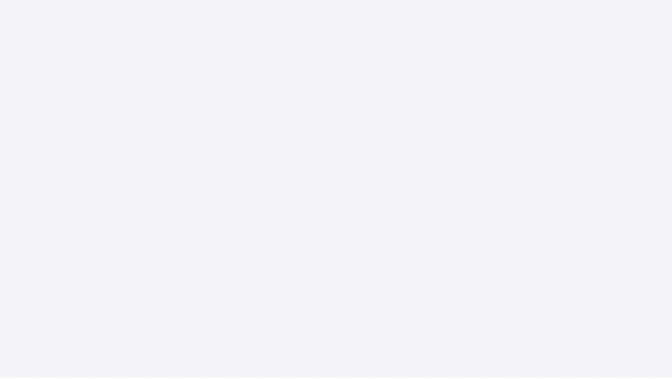
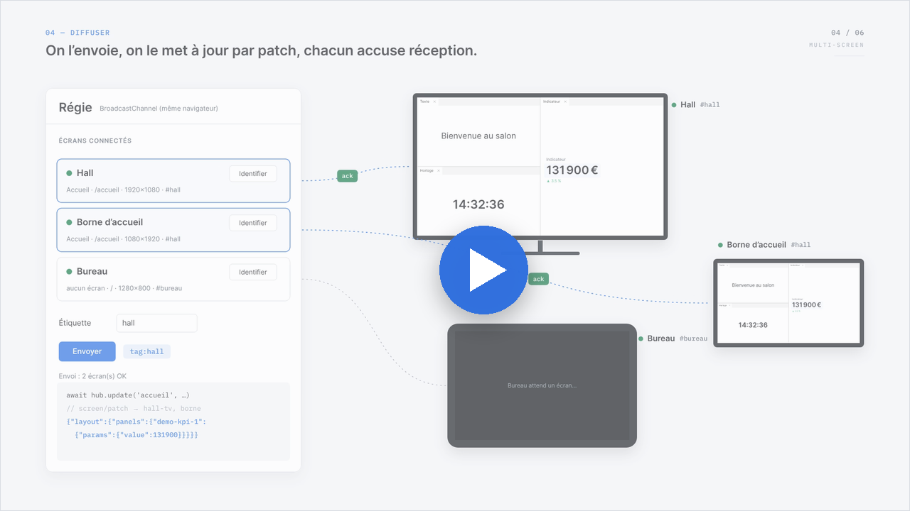
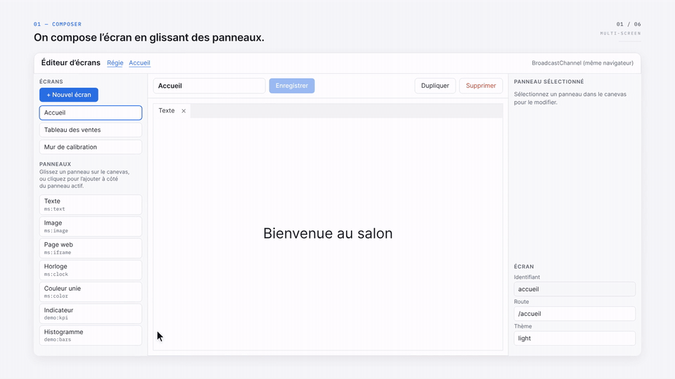
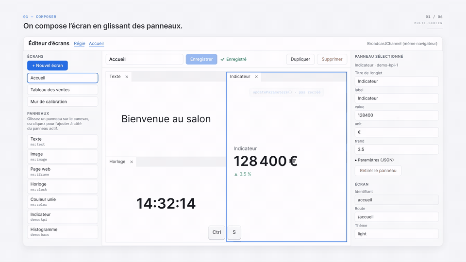
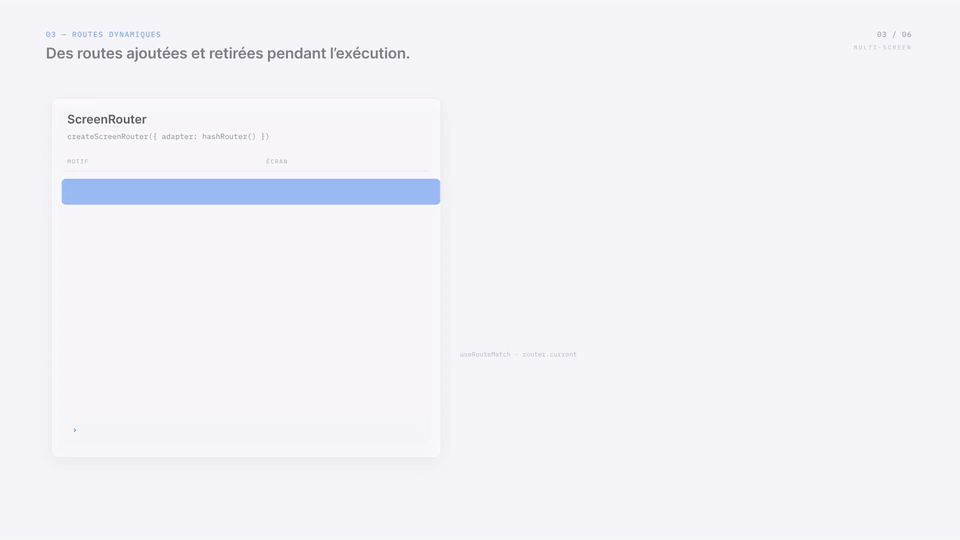
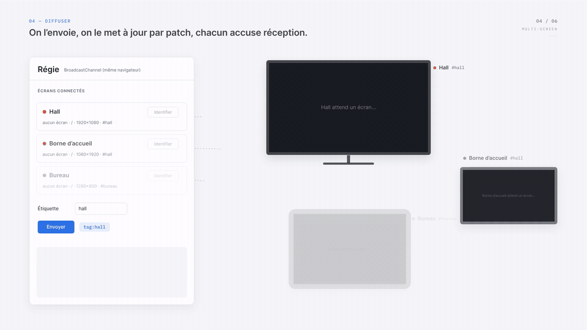
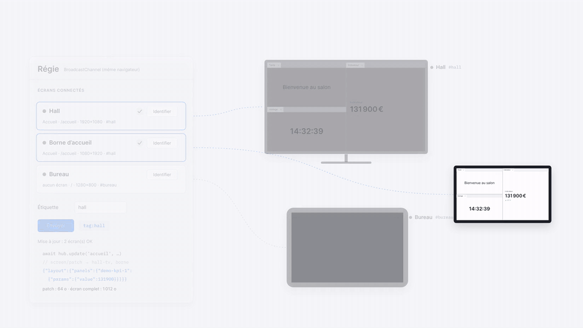
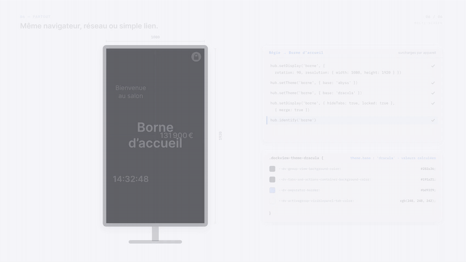

<p align="center">
  
</p>

<h3 align="center">Composez des écrans à partir de panneaux <a href="https://dockview.dev">dockview</a>,<br>routez-les à l'exécution, diffusez-les sur n'importe quel appareil.</h3>

<p align="center">
  <a href="https://github.com/alexandre-plana/multi-screen/actions/workflows/ci.yml"></a>
  
  
  
  
  <a href="LICENSE"></a>
</p>

<p align="center">
  <a href="#le-film"><strong>Le film</strong></a> ·
  <a href="https://alexandre-plana.github.io/multi-screen/">Démo en ligne</a> ·
  <a href="#guide-dutilisation">Guide d'utilisation</a> ·
  <a href="docs/ARCHITECTURE.md">Architecture</a> ·
  <a href="docs/PROTOCOL.md">Protocole</a> ·
  <a href="docs/en/README.md">English</a>
</p>

---

> **Un écran, c'est une donnée : on le compose, on le route, on l'envoie partout.**

multi-screen décrit un écran comme une **donnée JSON** : des panneaux dockview, un thème, des réglages d'affichage. Cette donnée se stocke, se versionne, se transforme en lien, ou s'**envoie à un appareil** qui l'affiche aussitôt.

Depuis une régie, on découvre les écrans connectés, on leur envoie une composition et on la met à jour en direct par patch. On peut aussi changer leur thème, les faire pivoter, les verrouiller ou les identifier. Chaque commande reçoit un accusé de réception.

## Le film

<p align="center">
  <a href="motion/out/multi-screen-demo.mp4"></a>
</p>

<p align="center"><sub>60 secondes · 1920 × 1080 · 60 i/s · avec le son — <a href="motion/out/multi-screen-demo.mp4">ouvrir la vidéo</a> · <a href="motion/README.md">note d'intention et fabrication</a></sub></p>

Le film est entièrement produit par le code du dépôt. Son JSON, ses routes, ses messages, son patch et son lien de partage sortent de la bibliothèque elle-même : rien n'a été dessiné à la main.

## Sommaire

- [En bref](#en-bref)
- [Installation](#installation)
- [Démarrage rapide](#démarrage-rapide)
- [Guide d'utilisation](#guide-dutilisation)
  1. [Composer un écran](#1-composer-un-écran)
  2. [L'écran est une donnée](#2-lécran-est-une-donnée)
  3. [Écrire des panneaux](#3-écrire-des-panneaux)
  4. [Router les écrans](#4-router-les-écrans)
  5. [Diffuser vers les appareils](#5-diffuser-vers-les-appareils)
  6. [Régler l'affichage et le thème](#6-régler-laffichage-et-le-thème)
  7. [Partout : transports, relais, liens, playlists](#7-partout--transports-relais-liens-playlists)
  8. [Gérer tous les écrans](#8-gérer-tous-les-écrans)
  9. [Avec React](#9-avec-react)
- [Sécurité](#sécurité) · [Développement](#développement) · [Compatibilité](#compatibilité) · [Documentation](#documentation)

## En bref

| | |
| --- | --- |
| **Écrans en JSON** | `ScreenDefinition` : panneaux déclaratifs *ou* disposition dockview exacte, thème, affichage, métadonnées. Validée à la réception, versionnée, sérialisable partout. |
| **Éditeur** | `createScreenEditor` : palette de panneaux à glisser sur un canevas dockview, inspecteur des paramètres, du thème et de l'affichage. |
| **Gestion des écrans** | `createScreenManager` : tous les écrans en miniatures vivantes, recherche, tri, diffusion, duplication, lien, import et export JSON. |
| **Routes dynamiques** | `ScreenRouter` ajoute, remplace et retire des routes pendant l'exécution (`/hall/:zone`, `/mur{/:index}`…), sur [`history`](https://github.com/remix-run/history) et [`path-to-regexp`](https://github.com/pillarjs/path-to-regexp), ou sur votre routeur. |
| **Régie et appareils** | `ScreenHub` ↔ `ScreenDevice` : envoyer, mettre à jour par patch, retirer, naviguer, thème, affichage, identification, commandes libres. Ciblage par id, par étiquette (`tag:hall`) ou global, avec accusés de réception. |
| **Transports** | BroadcastChannel, WebSocket (avec relais fourni), postMessage, mémoire, et une enveloppe signée HMAC. Une interface de deux méthodes pour en ajouter d'autres. |
| **Affichage et thèmes** | Résolution virtuelle, rotation, zoom, onglets masqués, verrouillage, curseur, plein écran, écran maintenu allumé ; tous les thèmes dockview et leurs variables CSS. |
| **Liens et playlists** | `createShareUrl` met l'écran entier dans l'URL (un QR code suffit, sans serveur) ; `createPlaylist` fait défiler des écrans. |
| **Ouvert** | Panneaux en JS pur, React (`reactPanel`) ou Web Components (`elementPanel`). Stockage, transport, routeur et autorisation sont remplaçables. |

## Installation

```bash
npm install multi-screen dockview
```

`dockview` n'est nécessaire que pour l'affichage (`multi-screen/dockview`). `react`, `react-dom` et `ws` sont facultatifs. Le paquet est en ESM ; la partie serveur demande Node 20 ou plus.

| Point d'entrée | Contenu | Dépendances |
| --- | --- | --- |
| `multi-screen` | modèle, store, routeur, régie, appareil, transports, liens, playlists | `history`, `path-to-regexp` |
| `multi-screen/dockview` | rendu, registre de panneaux, éditeur, gestionnaire, thèmes, affichage | `dockview` |
| `multi-screen/react` | `reactPanel`, `ScreenOutletView`, hooks | `react`, `react-dom` |
| `multi-screen/server` | relais WebSocket, commande `multi-screen-relay` | `ws` (ou tout serveur WebSocket) |

## Démarrage rapide

Trois fichiers suffisent : un appareil qui affiche, une régie qui pilote et, au besoin, un lien de partage.

**1. Un appareil qui affiche des écrans**

```ts
import 'dockview/dist/styles/dockview.css';
import { broadcastChannelTransport, createScreenDevice, createScreenRouter, hashRouter } from 'multi-screen';
import { createPanelRegistry, createScreenOutlet, registerBuiltinPanels } from 'multi-screen/dockview';

const registry = registerBuiltinPanels(createPanelRegistry()).register('meteo', ({ element, params }) => {
  element.textContent = `${params.ville} : ${params.temperature} °C`;
  return { update: (p) => (element.textContent = `${p.ville} : ${p.temperature} °C`) };
});

const device = createScreenDevice({
  transport: broadcastChannelTransport(),
  router: createScreenRouter({ adapter: hashRouter() }),
  info: { name: 'Hall d’accueil', tags: ['hall'] },
});

createScreenOutlet(document.getElementById('app')!, { registry, router: device.router, device });
```

**2. Une régie qui les pilote**

```ts
import { broadcastChannelTransport, createScreenHub } from 'multi-screen';

const hub = createScreenHub({ transport: broadcastChannelTransport() });

hub.subscribe((event) => {
  if (event.type === 'devices') console.table(event.devices.map((d) => [d.info.name, d.online, d.state.screenId]));
});

// Envoyer un écran à tous les appareils étiquetés « hall » : il est stocké,
// sa route /accueil est créée sur l'appareil, puis affichée.
hub.store.put({
  id: 'accueil',
  route: '/accueil',
  theme: { base: 'abyss' },
  display: { hideTabs: true, cursor: 'none' },
  panels: [
    { id: 'titre', component: 'ms:text', params: { text: 'Bienvenue' } },
    { id: 'meteo', component: 'meteo', params: { ville: 'Lyon', temperature: 14 }, position: { referencePanel: 'titre', direction: 'below' } },
  ],
});
await hub.show('tag:hall', 'accueil');

// Le mettre à jour : seuls les paramètres changent, les panneaux ne sont pas recréés.
await hub.update('accueil', { panels: [/* … */] });

// Thème, affichage, navigation, identification.
await hub.setTheme('tag:hall', { base: 'light', variables: { '--dv-background-color': '#fafafa' } });
await hub.setDisplay('tag:hall', { rotation: 90, resolution: { width: 1080, height: 1920 }, locked: true });
await hub.navigate('*', '/accueil');
await hub.identify('*');
```

**3. Un lien de partage**

```ts
import { createShareUrl } from 'multi-screen';

const url = await createShareUrl(hub.store.get('accueil')!, { baseUrl: 'https://ecrans.example.com/device.html' });
// https://ecrans.example.com/device.html#/share/z.jVHBbsIwDP0V...
```

Côté appareil, `decodeScreen(payload)` valide le contenu avant de l'afficher (voir [`examples/device.ts`](examples/device.ts)).

## Guide d'utilisation

### 1. Composer un écran

<p align="center"></p>

L'éditeur s'ouvre dans n'importe quel élément de la page. Sa palette est votre registre de panneaux.

```ts
import { createScreenEditor, editorLabelsFr } from 'multi-screen/dockview';

const editor = createScreenEditor(document.getElementById('editeur')!, {
  registry,                     // la palette = les composants enregistrés (ou `palette: ['ms:text', 'meteo']`)
  store: hub.store,             // la bibliothèque d'écrans
  labels: editorLabelsFr,       // textes en anglais par défaut
  actions: [{ label: 'Diffuser', run: (screen) => hub.show('*', screen) }],
});
```

- **Palette** : on glisse un panneau sur le canevas, au centre d'un groupe pour en faire un onglet ou sur un bord pour le diviser. On peut aussi cliquer pour l'ajouter à côté du panneau actif, au clavier compris.
- **Canevas** : c'est la disposition dockview elle-même. On y déplace les onglets, on redimensionne, on réorganise ; le canevas montre le thème et la résolution virtuelle de l'écran. Les réglages propres aux appareils (verrouillage, onglets masqués, curseur, rotation) ne s'y appliquent pas, pour ne pas gêner l'édition.
- **Inspecteur** : il présente le titre et les paramètres du panneau sélectionné, avec des champs générés à partir des `defaults` du registre (texte, nombre, case, couleur) et un éditeur JSON pour le reste. Il règle aussi la route, le thème, la résolution et l'affichage de l'écran.
- **Écrans** : création, duplication, suppression avec confirmation, renommage.
- **Enregistrement** : par le bouton, par Ctrl/Cmd+S ou automatiquement avec `autoSaveMs`. L'écran est enregistré avec sa disposition exacte (`layout`). Un écran modifié ailleurs est rechargé s'il n'y a pas de modifications en cours.
- **Apparence** : les couleurs de l'éditeur sont des variables CSS (`--mse-accent`, `--mse-bg`…), avec un mode sombre.

> [!TIP]
> Déclarez libellés et valeurs par défaut à l'enregistrement pour une palette utile : `registry.register('meteo', meteo, { label: 'Météo', defaults: { ville: 'Lyon' } })`. Avec le store `webStorage`, un écran enregistré dans l'éditeur apparaît aussitôt dans la régie, même dans un autre onglet.

### 2. L'écran est une donnée

<p align="center"></p>

```ts
interface ScreenDefinition {
  id: string;
  title?: string;
  route?: string;             // motif path-to-regexp : '/hall/:zone'
  panels?: PanelSpec[];       // déclaratif : { id, component, params, position }
  layout?: SerializedLayout;  // ou la sortie exacte de DockviewApi.toJSON()
  theme?: ThemeSpec;
  display?: DisplaySpec;
  meta?: JsonObject;          // libre, jamais interprété
  version?: number;           // géré par le store
  updatedAt?: string;
}
```

- **Deux formes.** Un écran **déclaratif** (`panels`) se lit et s'écrit à la main : chaque panneau se place par rapport à un autre (`left`, `right`, `above`, `below`, `within` pour un onglet). Un écran **exact** (`layout`) garde les tailles, les groupes flottants et l'onglet actif : c'est ce que produit `view.toScreen()`, donc l'éditeur. Si les deux sont présents, `layout` l'emporte.
- **Un store versionné.** `createScreenStore({ storage })` incrémente `version` à chaque changement réel, date `updatedAt` et prévient ses abonnés (`subscribe`). `webStorage('cle')` persiste dans `localStorage` et synchronise les onglets ; toute paire `{ load, save }` convient pour un serveur ou IndexedDB.
- **Comparable.** `contentHash(screen)` donne une empreinte du contenu, sans version ni date. `createMergePatch(avant, apres)` calcule un JSON Merge Patch (RFC 7396).
- **Validé.** `validateScreen` vérifie tout écran reçu du réseau, motifs de route compris.
- **Mises à jour incrémentales.** Si seuls les paramètres ou les titres changent, `updateParameters` est appelé sur les panneaux existants. La disposition n'est reconstruite que si sa structure a changé.

### 3. Écrire des panneaux

Un panneau est une fonction qui dessine dans un élément et peut, en option, recevoir les nouveaux paramètres :

```ts
registry.register('compteur', ({ element, params, api }) => {
  element.textContent = String(params.valeur);
  return {
    update: (p) => (element.textContent = String(p.valeur)),  // sinon le panneau est recréé
    dispose: () => {},
  };
}, { label: 'Compteur', defaults: { valeur: 0 } });
```

- **Intégrés**, utilisables sans livrer de code à l'appareil : `ms:text`, `ms:image`, `ms:iframe` (bac à sable par défaut), `ms:clock`, `ms:color`.
- **React** : `registry.register('graphique', reactPanel(MonGraphique))`. Le composant reçoit `{ id, params, api, containerApi }`.
- **Web Components** : `registry.register('carte', elementPanel('ma-carte', { allow: ['ville', 'zoom'] }))`. Les paramètres autorisés deviennent des propriétés de l'élément (Lit, Vue, Svelte, Angular Elements). Sans `allow`, une liste d'exclusion écarte `innerHTML`, `on*`, `src`, `href`, etc. ; les paramètres venant du réseau, préférez `allow`.
- **Composant inconnu** : un message explicite s'affiche, personnalisable avec `registry.setFallback`.

Le code des panneaux ne voyage jamais : un appareil n'affiche que les composants qu'il a enregistrés.

### 4. Router les écrans

<p align="center"></p>

```ts
import { browserRouter, createScreenRouter } from 'multi-screen';

const router = createScreenRouter({ adapter: browserRouter(), basePath: '/app' });

const retirer = router.addRoute({ path: '/hall/:zone', resolve: ({ zone }) => `hall-${zone}` });
router.addRoute({ id: 'principal', path: '/', screenId: 'accueil' });  // même id : remplace
router.setRoutes(routesDuServeur, { replaceAll: true });

router.navigateToScreen('hall-nord', { zone: 'nord' });
router.hrefFor('accueil');   // '/app/'
retirer();
```

- Tout écran stocké est joignable sans déclaration par `/screens/:screenId` (préfixe réglable, désactivable).
- Un écran qui porte une `route` la crée sur l'appareil qui le reçoit, et la retire quand il est supprimé.
- Ordre de correspondance : `priority` décroissante, puis le moins de paramètres, puis l'ordre d'ajout.
- Si la route courante change (ajout, retrait), l'écran affiché suit immédiatement.
- Trois adaptateurs sont fournis : `browserRouter` (historique), `hashRouter` (fragment `#`, pour les hébergements statiques et les bornes en `file://`) et `memoryRouter` (tests).

**Brancher votre routeur.** Implémentez `RouterAdapter` (trois membres) et passez-le à `createScreenRouter` :

```ts
// Exemple avec React Router (data router)
const adapter: RouterAdapter = {
  get location() { return reactRouter.state.location; },
  navigate: (path, o) => void reactRouter.navigate(path, { replace: o?.replace }),
  subscribe: (listener) => reactRouter.subscribe((state) => listener(state.location)),
};
```

Pourquoi `history` plutôt qu'un routeur de framework ? Les routes arrivent ici par le réseau, alors que React Router, TanStack Router ou Vue Router supposent un arbre connu à la compilation. Le raisonnement complet est dans [docs/ARCHITECTURE.md](docs/ARCHITECTURE.md).

### 5. Diffuser vers les appareils

<p align="center"></p>

```
 Régie (ScreenHub)                         Appareils (ScreenDevice)
 ─────────────────                         ────────────────────────
 hub/discover  ───────────────────────────▶  device/hello  (présence, état, écrans détenus)
 screen/show | screen/patch | theme/set ──▶  stocke, route, affiche
                                   ◀─────── ack (ok / erreur)
```

- **Cibles** : un id d'appareil, une étiquette (`'tag:hall'`), tous (`'*'`) ou une liste de ces formes.
- **Accusés** : chaque commande renvoie un `CommandResult` qui indique les appareils attendus (`expected`), leurs accusés (`acks`), les muets (`missing`) et `ok`.

  ```ts
  const { acks, missing } = await hub.show('tag:hall', 'accueil');
  ```

- **Qui affiche quoi** : l'appareil annonce son état (écran affiché, chemin, écrans détenus avec version et empreinte, surcharges actives), et `hub.devices()` le reflète.
- **Patch ou envoi complet** : `hub.update(id, patch)` envoie un **patch** aux appareils à jour et l'**écran complet** à ceux qui ont divergé.
- **Commandes métier** : `hub.command(cible, nom, données)` arrive comme un évènement `custom` sur l'appareil.
- **Autorisation** : `accept` et `deny` côté appareil, `acceptDevice` côté régie.
- **Surcharges persistantes** : `persistOverrides: 'cle'` conserve thème et affichage d'un appareil après un redémarrage.
- **Régie sans navigateur** : `ScreenHub` fonctionne dans Node, un worker ou une fonction serveur (voir [`examples/node-hub.mjs`](examples/node-hub.mjs)).

Le protocole est documenté dans [docs/PROTOCOL.md](docs/PROTOCOL.md) : un appareil peut être écrit dans un autre langage.

### 6. Régler l'affichage et le thème

<p align="center"></p>

Thème et affichage existent à deux niveaux. Ils sont définis dans l'écran pour tous les appareils, et chaque appareil peut recevoir une surcharge par `setTheme` ou `setDisplay`, qui l'emporte. On diffuse ainsi le même écran sur un mur paysage et sur une borne portrait.

```ts
await hub.setDisplay('borne', { rotation: 90, resolution: { width: 1080, height: 1920 } });
await hub.setTheme('borne', { base: 'dracula' });
await hub.setDisplay('borne', { hideTabs: true, locked: true }, { merge: true });
await hub.identify('borne');   // le nom de l'appareil en grand, 3 s
```

Tous les réglages d'affichage :

```ts
display: {
  resolution: { width: 1920, height: 1080 }, fit: 'contain',  // mise en page calculée en 1920×1080 puis ajustée
  rotation: 90,             // borne en portrait
  scale: 1.25,              // zoom manuel
  hideTabs: true, locked: true, cursor: 'none', background: '#000',
  fullscreen: true,         // demandé au navigateur ; refus signalé par onDisplayError
  wakeLock: true,           // Screen Wake Lock API, réacquis au retour de l'onglet
}
```

Le thème reprend tous les thèmes dockview par leur nom (`light`, `abyss`, `dracula`, `githubDark`…). On peut surcharger n'importe quelle variable `--dv-*` avec `variables`, ou enregistrer un thème maison avec `registerTheme(nom, themeDockview)`.

<p align="center"></p>

### 7. Partout : transports, relais, liens, playlists

<p align="center"></p>

| Transport | Portée | Usage |
| --- | --- | --- |
| `broadcastChannelTransport(nom)` | onglets et fenêtres d'un navigateur | mur d'écrans sur une machine, second moniteur |
| `webSocketTransport({ url })` | réseau | écrans répartis, avec le relais fourni |
| `postMessageTransport({ target, targetOrigin })` | iframe, popup | aperçu embarqué, intégration dans une autre application |
| `createMemoryBus().connect()` | même page | tests, prévisualisation |

Tout objet `{ send, subscribe }` est un transport : WebRTC, MQTT, SSE…

**Le relais WebSocket**

```bash
npx multi-screen-relay --port 8787     # nécessite le paquet ws
```

Chaque connexion choisit sa salle (`ws://hôte:8787/?room=magasin-12`). Le relais ne garde aucun écran : il route les messages selon leur destinataire et empêche un pair d'usurper l'identité d'un autre. Pour l'intégrer à votre serveur (Express, Fastify, Deno, Bun, Cloudflare…), `createRelay()` n'attend que des pairs capables de `send(texte)` :

```ts
import { WebSocketServer } from 'ws';
import { attachWebSocketServer, createRelay } from 'multi-screen/server';

attachWebSocketServer(new WebSocketServer({ server }), createRelay({
  authorize: (message, connection) => jetonValide(connection.room, message),
}));
```

**Messages signés.** Sur un réseau partagé, enveloppez n'importe quel transport. Chaque message est alors signé (HMAC-SHA256), et seuls les messages signés avec le même secret, récents et jamais vus sont délivrés.

```ts
const transport = signedTransport(webSocketTransport({ url }), { secret: secretDuSite });
```

La signature écarte les pairs qui n'ont pas le secret ; elle ne protège pas contre un appareil compromis. Fournissez le secret à l'installation de la borne plutôt que dans un bundle public.

**Liens de partage.** `createShareUrl(screen, { baseUrl })` place l'écran entier, compressé, dans le fragment de l'URL. Un QR code suffit, sans serveur. `decodeScreen` le valide à l'ouverture.

**Playlists.** Pour l'affichage dynamique, une playlist fait défiler des écrans par le routeur de l'appareil, et les URL restent cohérentes :

```ts
const playlist = createPlaylist({ router: device.router, items: [
  { screenId: 'accueil', durationMs: 20_000 },
  { screenId: 'promo', durationMs: 10_000, params: { n: '2' } },
] });

// Pilotée depuis la régie par une commande libre :
device.subscribe((e) => e.type === 'custom' && e.name === 'playlist' && playlist.setItems(e.data as PlaylistItem[]));
await hub.command('tag:hall', 'playlist', items);
```

### 8. Gérer tous les écrans


```ts
import { createScreenManager, managerLabelsFr } from 'multi-screen/dockview';

createScreenManager(document.getElementById('ecrans')!, {
  store: hub.store,      // la bibliothèque
  registry,              // pour les miniatures (facultatif)
  hub,                   // diffusion et « affiché sur … » (facultatif)
  onEdit: (id) => location.assign(`/editeur?screen=${id}`),
  shareBaseUrl: 'https://ecrans.example.com/device.html',
  labels: managerLabelsFr,
});
```

- **Vue d'ensemble** : une carte par écran. Elle montre sa miniature rendue comme sur un appareil (résolution virtuelle, thème, chargée à l'approche), son titre, sa route, sa version, son nombre de panneaux, son thème et sa date de modification. Tout se met à jour en direct.
- **Appareils** : chaque carte indique les appareils qui affichent l'écran.
- **Actions** : éditer (rappel `onEdit`), diffuser vers tous les appareils ou ceux que l'on coche, dupliquer, copier un lien de partage, exporter en JSON, supprimer avec confirmation. Un écran supprimé est aussi retiré des appareils qui le détiennent.
- **En masse** : recherche (titre, identifiant, route), tri, sélection multiple pour exporter ou supprimer. L'import JSON est validé et n'écrase jamais un identifiant existant.

### 9. Avec React

```tsx
import { ScreenOutletView, reactPanel, useDevices, useScreens } from 'multi-screen/react';

registry.register('graphique', reactPanel(({ params }) => <Graphique valeurs={params.valeurs} />));

function Regie() {
  const ecrans = useScreens(hub.store);   // se met à jour à chaque changement du store
  const appareils = useDevices(hub);      // présence et état des appareils
  return <ul>{appareils.map((d) => <li key={d.info.id}>{d.info.name} · {d.state.screenId ?? '—'}</li>)}</ul>;
}

const Appareil = () => <ScreenOutletView registry={registry} router={device.router} device={device} />;
```

Les hooks s'appuient sur `useSyncExternalStore` : `useScreens`, `useScreen`, `useDevices`, `useRouteMatch`, `useDeviceState`.

## Captures de la démo

| Régie | Éditeur |
| --- | --- |
|  |  |

La démo ([en ligne](https://alexandre-plana.github.io/multi-screen/) ou `npm run dev`) réunit le gestionnaire, l'éditeur, la régie et deux appareils, reliés par BroadcastChannel.

## Sécurité

Les écrans arrivent du réseau. Ils sont donc **validés** avant d'être stockés (`validateScreen`, motifs de route compris).

- **Panneaux intégrés** : ils n'insèrent jamais de HTML, seulement du texte et des attributs. `ms:iframe` est en bac à sable et n'accepte que `http(s)`.
- **Patch et routeur** : le JSON Merge Patch ignore `__proto__`, et une URL mal encodée (`%ZZ`) ne fait pas planter le routeur.
- **Liens de partage** : ils sont limités à 1 Mo une fois décompressés (`decodeScreen(lien, { maxBytes })`). Ils sont placés dans le fragment de l'URL, qui n'est pas envoyé au serveur.
- **Disposition invalide** : elle laisse une vue vide et cohérente, et l'erreur est remise à `onError`.

Pour un déploiement réseau, utilisez `wss://` et une salle par site. Contrôlez l'accès avec `createRelay({ authorize })` et `createScreenDevice({ accept })`.

## Développement

```bash
npm install
npm run dev               # démo : http://localhost:5173/ (gestionnaire, éditeur, régie, écrans)
npm test                  # tests unitaires (Node et jsdom)
npm run build:examples && npm run test:e2e   # parcours complet dans Chromium
npm run check             # typage, tests, build, archive installée, démo
```

La démo communique par BroadcastChannel. Pour piloter d'autres machines, lancez `npm run build && npm run relay`, puis ajoutez `?relay=ws://<hôte>:8787` aux adresses de la régie et des écrans.

Le film se régénère depuis le code (Playwright, ffmpeg, Python et numpy ; voir [motion/README.md](motion/README.md)) :

```bash
npm run build && node motion/data.mjs && cd motion && node render.cjs cues && python3 music.py && node render.cjs video 60
```

## Compatibilité

- dockview 4 et plus (tests passés avec 4.13 et 8.8) ; React 18.3 et 19 en option.
- Navigateurs récents (ES2022, BroadcastChannel, `structuredClone`). Les liens compressés utilisent `CompressionStream` lorsqu'il existe et basculent sinon sur du JSON non compressé.

## Documentation

- [Architecture et décisions](docs/ARCHITECTURE.md) : couches, choix du routeur, mises à jour incrémentales, points d'extension.
- [Protocole](docs/PROTOCOL.md) : messages entre régie et appareils, pour écrire un appareil dans un autre langage.
- [Film de démonstration](motion/README.md) : note d'intention, découpage, fabrication.
- [English version](docs/en/README.md).
- [Journal des changements](CHANGELOG.md).

## Licence

[MIT](LICENSE)
