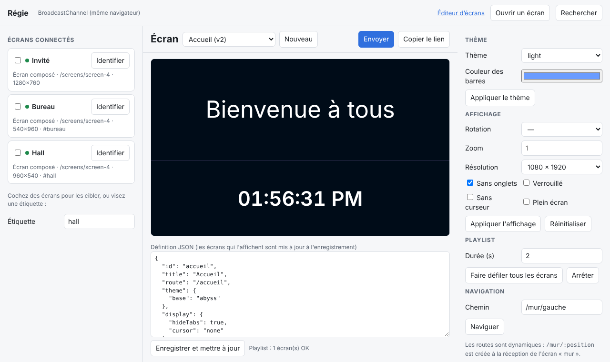
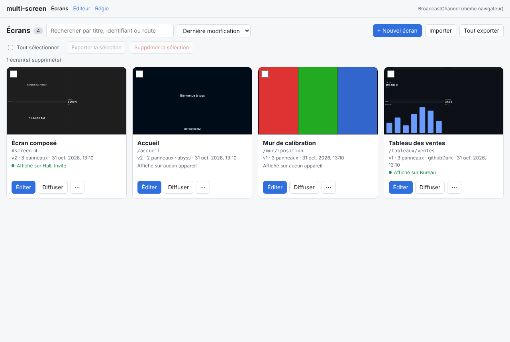
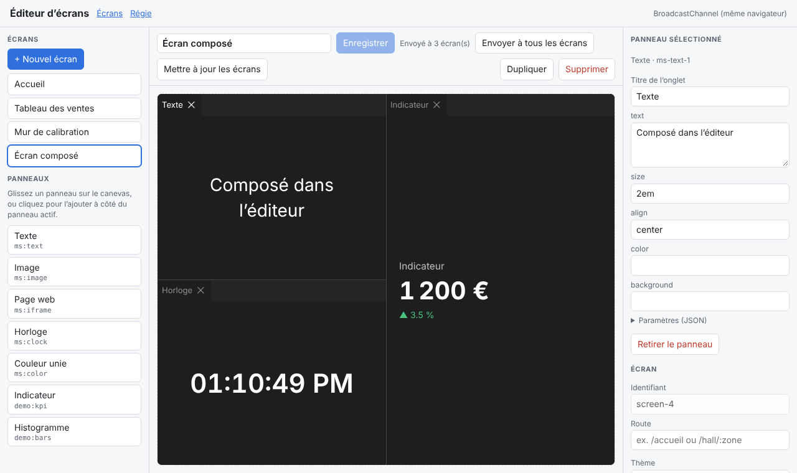
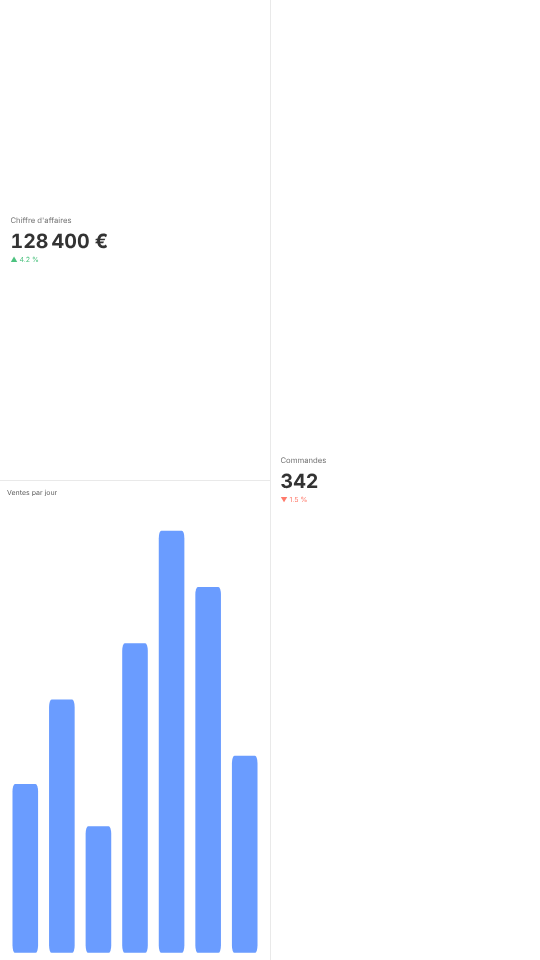

# multi-screen

**Composez des écrans à partir de panneaux [dockview](https://dockview.dev), créez leurs routes à l'exécution et pilotez-les à distance.**

[Démo en ligne](https://alexandre-plana.github.io/multi-screen/) · [Architecture](docs/ARCHITECTURE.md) · [Protocole](docs/PROTOCOL.md) · [English](docs/en/README.md)

TypeScript · sans framework (React en option) · licence MIT

---

multi-screen décrit un écran comme une **donnée JSON** : un ensemble de panneaux dockview, un thème, des réglages d'affichage. Cette donnée peut être stockée, modifiée, transformée en lien, ou **envoyée à un appareil** qui l'affiche aussitôt. Depuis une régie, on découvre les écrans connectés, on leur envoie une composition, on la met à jour en direct, on change leur thème, on les fait pivoter ou on les verrouille.



| | |
| --- | --- |
| **Écrans en JSON** | `ScreenDefinition` : panneaux déclaratifs *ou* disposition dockview exacte, thème, affichage, métadonnées. Validée à la réception, versionnée, sérialisable partout. |
| **Routes dynamiques** | `ScreenRouter` ajoute, remplace et retire des routes pendant l'exécution (`/hall/:zone`, `/mur{/:index}`…). Il s'appuie sur [`history`](https://github.com/remix-run/history) et [`path-to-regexp`](https://github.com/pillarjs/path-to-regexp), et accepte n'importe quel autre routeur par un adaptateur de trois méthodes. |
| **Partage** | `ScreenHub` (régie) ↔ `ScreenDevice` (écran) : envoyer, mettre à jour par patch, retirer, naviguer, thème, affichage, identification, commandes libres. Accusés de réception, ciblage par id, par étiquette (`tag:hall`) ou global. |
| **Transports** | BroadcastChannel (même navigateur), WebSocket (réseau, avec relais fourni), postMessage (iframes, popups), mémoire (tests), et une enveloppe de signature HMAC. Une interface de deux méthodes pour en écrire d'autres (WebRTC, MQTT, SSE…). |
| **Éditeur** | `createScreenEditor` : créer des écrans, y déposer des panneaux prédéfinis depuis une palette, les ordonner sur un canevas, régler leurs paramètres, le thème et l'affichage. |
| **Gestion des écrans** | `createScreenManager` : tous les écrans créés en miniatures vivantes, recherche, tri, appareils qui les affichent, diffusion, duplication, lien, import/export JSON, suppression unitaire ou groupée. |
| **Playlists** | Rotation d'écrans pour l'affichage dynamique, pilotable à distance. |
| **Liens** | `createShareUrl(screen)` met l'écran entier dans l'URL (compressé, dans le fragment) : un QR code suffit, sans serveur. |
| **Affichage** | Résolution virtuelle ajustée à l'écran, rotation 90/180/270°, zoom, onglets masqués, mise en page verrouillée, curseur caché, plein écran, écran maintenu allumé. |
| **Thèmes** | Tous les thèmes dockview par leur nom (`abyss`, `dracula`, `githubDark`…), surcharge de n'importe quelle variable CSS, thèmes personnels enregistrables. |
| **Ouvert** | Panneaux écrits en JS pur, React (`reactPanel`), ou Web Components (`elementPanel` : Lit, Vue, Svelte, Angular Elements). Stockage, transport, routeur et autorisation sont tous remplaçables. |

## Installation

```bash
npm install multi-screen dockview
```

`dockview` n'est nécessaire que pour l'affichage (`multi-screen/dockview`). `react`, `react-dom` et `ws` sont facultatifs. Le paquet est en ESM, Node 20 et plus pour la partie serveur.

| Point d'entrée | Contenu | Dépendances |
| --- | --- | --- |
| `multi-screen` | modèle, store, routeur, régie, appareil, transports, liens | `history`, `path-to-regexp` |
| `multi-screen/dockview` | rendu, registre de panneaux, thèmes, affichage | `dockview` |
| `multi-screen/react` | `reactPanel`, `ScreenOutletView`, hooks | `react`, `react-dom` |
| `multi-screen/server` | relais WebSocket, commande `multi-screen-relay` | `ws` (ou tout serveur WebSocket) |

## Démarrage rapide

### 1. Un appareil qui affiche des écrans

```ts
import 'dockview/dist/styles/dockview.css';
import { broadcastChannelTransport, createScreenDevice, createScreenRouter, hashRouter } from 'multi-screen';
import { createPanelRegistry, createScreenOutlet, registerBuiltinPanels } from 'multi-screen/dockview';

const registry = registerBuiltinPanels(createPanelRegistry()).register('meteo', ({ element, params }) => {
  element.textContent = `${params.ville} : ${params.temperature} °C`;
  return { update: (p) => (element.textContent = `${p.ville} : ${p.temperature} °C`) };
});

const device = createScreenDevice({
  transport: broadcastChannelTransport(),
  router: createScreenRouter({ adapter: hashRouter() }),
  info: { name: 'Hall d’accueil', tags: ['hall'] },
});

createScreenOutlet(document.getElementById('app')!, { registry, router: device.router, device });
```

### 2. Une régie qui les pilote

```ts
import { broadcastChannelTransport, createScreenHub } from 'multi-screen';

const hub = createScreenHub({ transport: broadcastChannelTransport() });

hub.subscribe((event) => {
  if (event.type === 'devices') console.table(event.devices.map((d) => [d.info.name, d.online, d.state.screenId]));
});

// Envoyer un écran à tous les appareils étiquetés « hall » : il est stocké,
// sa route /accueil est créée sur l'appareil, puis affichée.
hub.store.put({
  id: 'accueil',
  route: '/accueil',
  theme: { base: 'abyss' },
  display: { hideTabs: true, cursor: 'none' },
  panels: [
    { id: 'titre', component: 'ms:text', params: { text: 'Bienvenue' } },
    { id: 'meteo', component: 'meteo', params: { ville: 'Lyon', temperature: 14 }, position: { referencePanel: 'titre', direction: 'below' } },
  ],
});
await hub.show('tag:hall', 'accueil');

// Le mettre à jour : seuls les paramètres changent, les panneaux ne sont pas recréés.
await hub.update('accueil', { panels: [/* … */] });

// Thème, affichage, navigation, identification.
await hub.setTheme('tag:hall', { base: 'light', variables: { '--dv-background-color': '#fafafa' } });
await hub.setDisplay('tag:hall', { rotation: 90, resolution: { width: 1080, height: 1920 }, locked: true });
await hub.navigate('*', '/accueil');
await hub.identify('*');
```

Chaque commande renvoie un `CommandResult` : appareils attendus, accusés de réception, appareils muets.

### 3. Un lien de partage

```ts
import { createShareUrl } from 'multi-screen';

const url = await createShareUrl(hub.store.get('accueil')!, { baseUrl: 'https://ecrans.example.com/device.html' });
// https://ecrans.example.com/device.html#/share/z.jVHBbsIwDP0V...
```

Côté appareil, `decodeScreen(payload)` valide le contenu avant de l'afficher (voir [`examples/device.ts`](examples/device.ts)).

## Concepts

### L'écran

```ts
interface ScreenDefinition {
  id: string;
  title?: string;
  route?: string;             // motif path-to-regexp : '/hall/:zone'
  panels?: PanelSpec[];       // déclaratif : { id, component, params, position }
  layout?: SerializedLayout;  // ou la sortie exacte de DockviewApi.toJSON()
  theme?: ThemeSpec;
  display?: DisplaySpec;
  meta?: JsonObject;          // libre, jamais interprété
  version?: number;           // géré par le store
  updatedAt?: string;
}
```

Un écran **déclaratif** (`panels`) se lit et s'écrit à la main : chaque panneau se place par rapport à un autre (`left`, `right`, `above`, `below`, `within` pour un onglet). Un écran **exact** (`layout`) garde les tailles, les groupes flottants et l'onglet actif : c'est ce que produit `view.toScreen()` après qu'un utilisateur a réorganisé l'aperçu.

Les mises à jour sont **incrémentales** : si seuls les paramètres ou les titres changent, `updateParameters` est appelé sur les panneaux existants ; la disposition n'est reconstruite que si sa structure a changé.

### Les panneaux

Un panneau est une fonction qui dessine dans un élément et peut, en option, recevoir les nouveaux paramètres :

```ts
registry.register('compteur', ({ element, params, api }) => {
  element.textContent = String(params.valeur);
  return {
    update: (p) => (element.textContent = String(p.valeur)),  // sinon le panneau est recréé
    dispose: () => {},
  };
}, { label: 'Compteur', defaults: { valeur: 0 } });
```

- **React** : `registry.register('graphique', reactPanel(MonGraphique))` — le composant reçoit `{ id, params, api, containerApi }`.
- **Web Components** : `registry.register('carte', elementPanel('ma-carte', { allow: ['ville', 'zoom'] }))` — les paramètres autorisés deviennent des propriétés de l'élément. Sans `allow`, une liste d'exclusion écarte `innerHTML`, `on*`, `src`, `href`, etc. ; préférez `allow`, les paramètres venant du réseau.
- **Intégrés**, utilisables sans livrer de code à l'appareil : `ms:text`, `ms:image`, `ms:iframe` (bac à sable par défaut), `ms:clock`, `ms:color`.
- Un composant inconnu affiche un message explicite (personnalisable avec `registry.setFallback`).

### La gestion des écrans



```ts
import { createScreenManager, managerLabelsFr } from 'multi-screen/dockview';

createScreenManager(document.getElementById('ecrans')!, {
  store: hub.store,      // la bibliothèque
  registry,              // pour les miniatures (facultatif)
  hub,                   // diffusion et « affiché sur … » (facultatif)
  onEdit: (id) => location.assign(`/editeur?screen=${id}`),
  shareBaseUrl: 'https://ecrans.example.com/device.html',
  labels: managerLabelsFr,
});
```

- **Vue d'ensemble** : une carte par écran, avec sa miniature rendue comme sur un appareil (résolution virtuelle, thème) et chargée à l'approche de l'écran, son titre, sa route, sa version, son nombre de panneaux, son thème et sa date de modification. Tout se met à jour en direct.
- **Appareils** : chaque carte indique les appareils qui affichent l'écran.
- **Actions** : éditer (rappel `onEdit`), diffuser vers tous les appareils ou ceux que l'on coche, dupliquer, copier un lien de partage, exporter en JSON, supprimer avec confirmation. Un écran supprimé est aussi retiré des appareils qui le détiennent.
- **En masse** : recherche (titre, identifiant, route), tri (date, titre, identifiant), sélection multiple pour exporter ou supprimer, import de fichiers JSON (un écran ou une liste, validés ; un identifiant existant n'est jamais écrasé).

### L'éditeur d'écrans



```ts
import { builtinPanelLabelsFr, createScreenEditor, editorLabelsFr, registerBuiltinPanels } from 'multi-screen/dockview';

const editor = createScreenEditor(document.getElementById('editeur')!, {
  registry,                     // la palette = les composants enregistrés (ou `palette: ['ms:text', 'meteo']`)
  store: hub.store,             // la bibliothèque d'écrans
  labels: editorLabelsFr,       // textes en anglais par défaut
  actions: [{ label: 'Diffuser', run: (screen) => hub.show('*', screen) }],
});
```

- **Écrans** : création, duplication, suppression (avec confirmation), renommage.
- **Palette** : chaque composant du registre, avec son `label`. On le **glisse sur le canevas** (au centre d'un groupe pour un onglet, sur un bord pour le diviser), ou on clique pour l'ajouter à côté du panneau actif (accessible au clavier).
- **Canevas** : la disposition dockview elle-même. On y déplace les onglets, on redimensionne, on réorganise ; le canevas montre le thème et la résolution virtuelle de l'écran. Les réglages propres aux appareils (verrouillage, onglets masqués, curseur, rotation) ne s'y appliquent pas pour ne pas gêner l'édition.
- **Inspecteur** : titre et paramètres du panneau sélectionné, avec des champs générés à partir des `defaults` déclarés au registre (texte, nombre, case, couleur) et un éditeur JSON pour le reste ; route, thème, résolution et réglages d'affichage de l'écran.
- **Enregistrement** : bouton, Ctrl/Cmd+S ou `autoSaveMs`. L'écran est enregistré avec sa disposition exacte (`layout`). Un écran modifié ailleurs est rechargé s'il n'y a pas de modifications en cours.
- Les couleurs de l'éditeur sont des variables CSS (`--mse-accent`, `--mse-bg`…), avec un mode sombre.

Pour que la palette soit utile, déclarez libellés et valeurs par défaut à l'enregistrement : `registry.register('meteo', meteo, { label: 'Météo', defaults: { ville: 'Lyon' } })`. Le store `webStorage` se synchronise entre onglets : un écran enregistré dans l'éditeur apparaît aussitôt dans la régie.

### Les routes dynamiques

```ts
const router = createScreenRouter({ adapter: browserRouter(), basePath: '/app' });

const retirer = router.addRoute({ path: '/hall/:zone', resolve: ({ zone }) => `hall-${zone}` });
router.addRoute({ id: 'principal', path: '/', screenId: 'accueil' });  // même id : remplace
router.setRoutes(routesDuServeur, { replaceAll: true });

router.navigateToScreen('hall-nord', { zone: 'nord' });
router.hrefFor('accueil');   // '/app/'
retirer();
```

- Tout écran stocké est joignable sans déclaration par `/screens/:screenId` (préfixe réglable, désactivable).
- Un écran qui porte une `route` la crée sur l'appareil qui le reçoit, et la retire quand il est supprimé.
- Ordre de correspondance : `priority` décroissante, puis le moins de paramètres, puis l'ordre d'ajout.
- Si la route courante change (ajout, retrait), l'écran affiché suit immédiatement.

**Pourquoi `history` ?** C'est la brique d'historique la plus utilisée de l'écosystème, sans dépendance à un framework, et elle offre les trois modes utiles ici (navigateur, fragment `#` pour les hébergements statiques et les bornes en `file://`, mémoire pour les tests). Les routeurs de framework (React Router, TanStack Router, Vue Router) supposent un arbre de routes connu à la compilation ; ici les routes arrivent par le réseau. Le raisonnement complet est dans [docs/ARCHITECTURE.md](docs/ARCHITECTURE.md).

**Brancher votre routeur** : implémentez `RouterAdapter` (trois membres) et passez-le à `createScreenRouter`.

```ts
// Exemple avec React Router (data router)
const adapter: RouterAdapter = {
  get location() { return reactRouter.state.location; },
  navigate: (path, o) => void reactRouter.navigate(path, { replace: o?.replace }),
  subscribe: (listener) => reactRouter.subscribe((state) => listener(state.location)),
};
```

### Régie, appareils et transports

```
 Régie (ScreenHub)                         Appareils (ScreenDevice)
 ─────────────────                         ────────────────────────
 hub/discover  ───────────────────────────▶  device/hello  (présence, état, écrans détenus)
 screen/show | screen/patch | theme/set ──▶  stocke, route, affiche
                                   ◀─────── ack (ok / erreur)
```

- L'appareil annonce son état : écran affiché, chemin, écrans détenus (version + empreinte du contenu), surcharges actives. La régie sait donc qui affiche quoi.
- `hub.update(id, patch)` envoie un **patch** aux appareils à jour et l'**écran complet** à ceux qui ont divergé.
- Thème et affichage existent à deux niveaux : dans l'écran (pour tous) et par appareil (`setTheme`, `setDisplay`), le second l'emportant.
- `accept` (appareil) et `acceptDevice` (régie) sont les points d'autorisation ; `deny` refuse des commandes précises.
- `persistOverrides: 'cle'` conserve les surcharges de thème et d'affichage d'un appareil après un redémarrage (localStorage, ou tout stockage `{ load, save }`).
- La régie n'a pas besoin de navigateur : `ScreenHub` fonctionne dans Node, un worker ou une fonction serveur (voir [`examples/node-hub.mjs`](examples/node-hub.mjs)).

| Transport | Portée | Usage |
| --- | --- | --- |
| `broadcastChannelTransport(nom)` | onglets et fenêtres d'un navigateur | mur d'écrans sur une machine, second moniteur |
| `webSocketTransport({ url })` | réseau | écrans répartis, avec le relais fourni |
| `postMessageTransport({ target, targetOrigin })` | iframe, popup | aperçu embarqué, intégration dans une autre application |
| `createMemoryBus().connect()` | même page | tests, prévisualisation |

Le protocole est documenté dans [docs/PROTOCOL.md](docs/PROTOCOL.md) : un appareil peut être écrit dans un autre langage.

### Signature des messages

Sur un réseau partagé, enveloppez n'importe quel transport : chaque message est signé (HMAC-SHA256), et seuls les messages signés avec le même secret, récents et jamais vus sont délivrés.

```ts
const transport = signedTransport(webSocketTransport({ url }), { secret: secretDuSite });
```

Le secret est connu de chaque appareil : la signature écarte les pairs qui ne le possèdent pas, elle ne protège pas contre un appareil compromis. Évitez de l'inscrire dans un bundle public ; fournissez-le à l'installation de la borne.

### Playlists

Pour l'affichage dynamique, une playlist fait défiler des écrans par le routeur de l'appareil (les URL restent cohérentes) :

```ts
const playlist = createPlaylist({ router: device.router, items: [
  { screenId: 'accueil', durationMs: 20_000 },
  { screenId: 'promo', durationMs: 10_000, params: { n: '2' } },
] });

// Pilotée depuis la régie par une commande libre :
device.subscribe((e) => e.type === 'custom' && e.name === 'playlist' && playlist.setItems(e.data as PlaylistItem[]));
await hub.command('tag:hall', 'playlist', items);
```

### Le relais WebSocket

```bash
npx multi-screen-relay --port 8787     # nécessite le paquet ws
```

Chaque connexion choisit sa salle (`ws://hôte:8787/?room=magasin-12`). Le relais ne garde aucun écran ; il route les messages selon leur destinataire et empêche un pair d'usurper l'identité d'un autre. Pour l'intégrer à votre serveur (Express, Fastify, Deno, Bun, Cloudflare…), `createRelay()` n'attend que des pairs capables de `send(texte)` :

```ts
import { WebSocketServer } from 'ws';
import { attachWebSocketServer, createRelay } from 'multi-screen/server';

attachWebSocketServer(new WebSocketServer({ server }), createRelay({
  authorize: (message, connection) => jetonValide(connection.room, message),
}));
```

### L'affichage

```ts
display: {
  resolution: { width: 1920, height: 1080 }, fit: 'contain',  // la mise en page est calculée en 1920×1080 puis ajustée
  rotation: 90,             // borne en portrait
  scale: 1.25,              // zoom manuel
  hideTabs: true, locked: true, cursor: 'none', background: '#000',
  fullscreen: true,         // demandé au navigateur ; refus signalé par onDisplayError
  wakeLock: true,           // Screen Wake Lock API, réacquis au retour de l'onglet
}
```



## Sécurité

Les écrans arrivent du réseau : ils sont **validés** (`validateScreen`, motifs de route compris) avant d'être stockés, et les panneaux intégrés n'insèrent jamais de HTML (texte et attributs uniquement ; `ms:iframe` est en bac à sable et n'accepte que `http(s)`). Le JSON Merge Patch ignore `__proto__`. Un lien de partage est limité à 1 Mo une fois décompressé (`decodeScreen(lien, { maxBytes })`). Une URL mal encodée (`%ZZ`) ne fait pas planter le routeur. Une disposition invalide laisse une vue vide et cohérente, et l'erreur est remise à `onError` de l'outlet. Les liens de partage sont placés dans le fragment de l'URL, qui n'est pas envoyé au serveur. Pour un déploiement réseau, utilisez `wss://`, une salle par site, et un contrôle d'accès dans `createRelay({ authorize })` et `createScreenDevice({ accept })`.

## Développement

```bash
npm install
npm run dev               # démo : http://localhost:5173/ (régie + écrans)
npm test                  # tests unitaires (Node et jsdom)
npm run build:examples && npm run test:e2e   # parcours complet dans Chromium
npm run check             # typage, tests, build, archive installée, démo
```

La démo communique par BroadcastChannel. Pour piloter d'autres machines : `npm run build && npm run relay`, puis ajoutez `?relay=ws://<hôte>:8787` aux adresses de la régie et des écrans.

## Compatibilité

- dockview 4 et plus (tests passés avec 4.13 et 8.8) ; React 18.3 et 19 en option.
- Navigateurs récents (ES2022, BroadcastChannel, `structuredClone`). Les liens compressés utilisent `CompressionStream` lorsqu'il existe et basculent sinon sur du JSON non compressé.

## Licence

MIT
