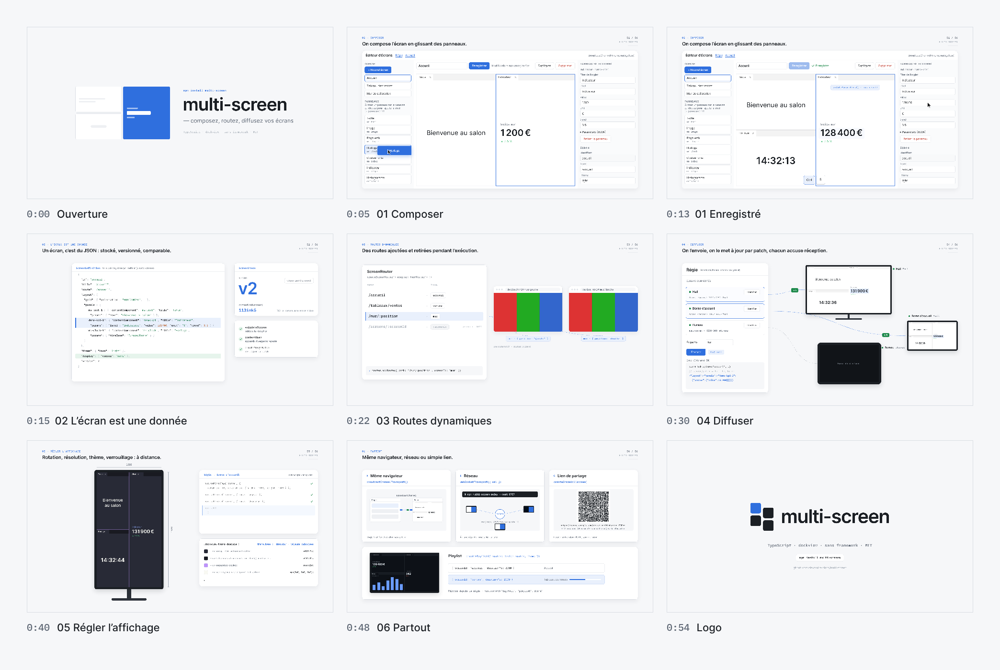

# multi-screen — film de démonstration (60 s)

Film de motion design pour présenter multi-screen : 60 secondes, 1920 × 1080, 60 i/s, avec une bande-son électronique minimale. Tout est produit par le code de ce dossier : aucune capture d'écran, aucun logiciel de montage.



- Vidéo : [`out/multi-screen-demo.mp4`](out/multi-screen-demo.mp4)
- Prévisualisation interactive : ouvrir `index.html` (Espace pour lire ou mettre en pause, curseur pour se déplacer)

## Note d'intention

Le film ne dit qu'une chose : **un écran, c'est une donnée : on le compose, on le route, on l'envoie partout.**

Un seul objet sert de fil conducteur : un petit panneau rectangulaire bleu (`#2F6FDE`, rayon 6 px, l'accent de la démo). Il se dessine, s'étire en grille dockview à trois zones et révèle le titre. Il naît ensuite dans la palette de l'éditeur, se pose sur le canevas et le divise. Il devient la ligne surlignée de l'écran dans le JSON, puis la route active du routeur. Il voyage ensuite comme message vers les appareils, pivote avec la borne et change de couleur avec les thèmes. À la fin, il devient le carré bleu du logo.

Chaque mouvement montre une fonction réelle. Aucune transition n'est gratuite : le canevas se replie en JSON parce que l'écran **est** ce JSON. La ligne de route vole jusqu'au routeur parce que la route vient de l'écran. Le patch voyage en petit paquet parce qu'il fait 64 octets et non 1 ko.

Le style est éditorial : beaucoup d'air, des cartes blanches sur un fond `#F6F7F9`, des filets de 1 px `#D9DDE3` et un texte `#1B1F24`. Une légende de chapitre est placée en haut à gauche (numéro en Plex Mono, phrase-titre en Inter) et un folio en haut à droite. Les mouvements décélèrent (`outCubic`, `outExpo`) et les changements de cadre utilisent `inOutCubic`. Les appareils sont des cadres sobres (téléviseur 16:9, borne, tablette), reliés à la régie par de fines lignes pointillées où circulent les messages.

## Exactitude

Le film ne montre que ce qui existe dans le dépôt, avec les noms d'API et les textes d'interface réels (éditeur en `editorLabelsFr`, régie de `examples/control.ts`, panneaux de `examples/shared.ts`).

Les données affichées ne sont pas écrites à la main : `data.mjs` les obtient de la bibliothèque compilée (`dist/`).

| Ce que l'on voit | D'où ça vient |
| --- | --- |
| Le JSON de l'écran (chapitre 02) | La composition montée dans dockview (jsdom) par `mountScreen`, puis sérialisée par `view.toScreen()`, comme le fait l'éditeur |
| `v1 → v2` et les empreintes | `ScreenStore.put` et `contentHash` |
| Les routes, leur ordre, `{ position: "gauche" }`, l'écran vide après le retrait | Deux `ScreenRouter` sur `memoryRouter`, `addRoute` puis `removeRoute` |
| `device/hello`, `screen/show`, `ack`, le patch `{"layout":{"panels":{"demo-kpi-1":{"params":{"value":131900}}}}}` | Un `ScreenHub` et trois `ScreenDevice` reliés par `createMemoryBus()`, les messages relevés sur le bus |
| « patch : 64 o · écran complet : 1 012 o » | Les tailles de ces messages |
| Les réglages de la borne | La même séquence `setDisplay` / `setTheme` / `setDisplay(…, { merge: true })` / `identify`, exécutée sur l'appareil |
| Le lien de partage et son QR code | `createShareUrl(screen)` ; QR calculé par `segno`, lisible (correction L, sans logo par-dessus) |
| Les couleurs Clair, Abyss, Dracula, githubDark | Les variables `--dv-*` de `dockview/dist/styles/dockview.css` (8.8.3), valeurs calculées |

En préparant ces données, le film a mis au jour un défaut : `createMergePatch` produisait une suppression `null` pour chaque champ `undefined` de la disposition dockview. Le défaut est corrigé dans `src/core/patch.ts`, et un test le couvre.

## Découpage

| Temps | Séquence | Ce que l'on voit | Son |
| --- | --- | --- | --- |
| 0:00 – 0:05 | **Ouverture** | Le panneau bleu se dessine, s'étire en grille dockview à trois zones, puis révèle « multi-screen — composez, routez, diffusez vos écrans ». La grille se pose à la place du canevas. | Nappe en ré majeur 9, souffle, cloche, deux notes pincées aux divisions |
| 0:05 – 0:15 | **01 Composer** | L'éditeur d'écrans : palette (Texte, Image, Page web, Horloge, Couleur unie, Indicateur, Histogramme), canevas, inspecteur. On glisse « Indicateur » sur le bord droit (surbrillance de dépôt, le groupe se divise), puis « Horloge » en bas du Texte. On sélectionne l'Indicateur, on tape `128400` dans `value`, puis Entrée : seule la valeur change (`updateParameters() · pas recréé`). Ctrl + S : « Enregistré ». | Le kick entre ; clic doux et note à chaque dépôt, touches, carillon d'enregistrement |
| 0:15 – 0:22 | **02 L'écran est une donnée** | Le canevas se replie : chaque panneau devient ses lignes dans le JSON (`id`, `route`, `layout.panels`, `theme`). La ligne `display` s'insère, `store.put` fait passer la version de `v1` à `v2` et l'empreinte change. | Souffle inversé, cloches de version |
| 0:22 – 0:30 | **03 Routes dynamiques** | La ligne `"route"` vole jusqu'au `ScreenRouter`. Trois routes sont ajoutées en direct (`/accueil`, `/tableaux/ventes`, `/mur/:position`), sous la route intégrée `/screens/:screenId` (priorité −1000). `#/mur/gauche` et `#/mur/droite` affichent le même écran avec des paramètres différents. `removeRoute('/mur/:position')` : les deux navigateurs affichent aussitôt « Aucun écran pour … ». | Notes ascendantes à chaque route, descendantes au retrait |
| 0:30 – 0:40 | **04 Diffuser** | La régie découvre trois appareils (`device/hello`, pastilles vertes, `#hall` `#bureau`). « Envoyer » vers `tag:hall` : `screen/show` voyage vers le téléviseur et la borne, les accusés `ack` reviennent avec des coches. Le Bureau, hors cible, attend toujours. `hub.update` envoie ensuite un patch minuscule : seul l'indicateur passe à 131 900 € sur les deux écrans. | Ping par message, ping aigu à deux notes par accusé |
| 0:40 – 0:48 | **05 Régler l'affichage** | La borne pivote physiquement. `setDisplay({ rotation: 90, resolution: 1080 × 1920 })` redresse et recompose l'image. Viennent ensuite deux volets de thème, Clair → Abyss → Dracula, avec les variables `--dv-*` sur une carte de code. Les onglets sont masqués, la mise en page est verrouillée (cadenas). `identify` affiche « Borne d'accueil » en grand. | Pivot grave, souffle et cloche à chaque thème, déclic du verrou |
| 0:48 – 0:54 | **06 Partout** | Trois chemins en une image : même navigateur (`broadcastChannelTransport()`), réseau (`npx multi-screen-relay --port 8787`, une salle par site) et lien de partage (QR code réel, 612 caractères, sans serveur). Une playlist fait défiler Accueil et Tableau des ventes sur le téléviseur. | Trois notes pincées, pings de playlist |
| 0:54 – 1:00 | **Logo** | Les cartes se rassemblent en une grille de quatre carrés décalés, dont un seul bleu. Le mot « multi-screen » apparaît, puis « TypeScript · dockview · sans framework · MIT » et `npm install multi-screen`. | Montée, accord final en ré majeur 9 |

## Système graphique

| Rôle | Valeur |
| --- | --- |
| Fond | `#F6F7F9` |
| Cartes | `#FFFFFF`, rayon 14 px, ombre très diffuse |
| Filets | `#D9DDE3`, 1 px |
| Texte | `#1B1F24`, secondaire `#5D6673` |
| Accent (le panneau bleu) | `#2F6FDE`, fond teinté `#E9F0FC` |
| En ligne, accusés | `#1F8A4C` |
| Typographie | Inter 400/500/600 pour les titres et l'interface ; IBM Plex Mono 400/500/600 pour le code, les routes et le JSON |

## Musique

Le morceau est entièrement synthétisé par `music.py` avec numpy, sans échantillon : 100 BPM, une mesure dure 2,4 s. La grille harmonique est ré majeur 9, si mineur 9, sol majeur 9, mi mineur 9 et la 6, avec une suspension avant le logo. Elle se résout sur l'accord final.

Le morceau combine une nappe additive, un kick doux avec compression latérale, une charleston en contretemps, une basse et des arpèges pincés en écho, dans une réverbération à convolution. Le kick s'interrompt pendant le repli en JSON et pendant le zoom vers la borne. Les effets sont calés à l'image près sur les repères exportés par la scène (`out/cues.json`). Le niveau intégré est d'environ −14 LUFS et la crête à −1 dBFS.

## Fabrication

Toute l'image est une fonction pure du temps, `MS.render(ctx, t)` dans `scene.js` (Canvas 2D). Le rendu est donc déterministe, image par image.

```bash
npm run build                               # la bibliothèque, utilisée par data.mjs
node motion/data.mjs                        # données réelles → motion/data.js
cd motion
node render.cjs cues                        # repères sonores → out/cues.json
python3 music.py                            # bande-son → out/music.wav
node render.cjs video 60                    # 3 600 images → out/multi-screen-demo.mp4 (H.264 + AAC)
node render.cjs board                       # planche → out/storyboard.png, out/poster.png
node render.cjs stills 9,20,36,46 out/img   # images de contrôle
```

Il faut Node 20 ou plus, les dépendances de développement du dépôt (`npm install`, pour jsdom et dockview), Playwright avec Chromium et ffmpeg (libx264). Il faut aussi Python 3 avec numpy, et `segno` pour le QR code (`pip install segno`). Sans `segno`, la carte du lien de partage n'affiche pas de code.

Les polices Inter et IBM Plex Mono sont incluses dans `fonts/` (licence SIL OFL 1.1). Les données affichées (salon, chiffres, appareils) sont fictives.
